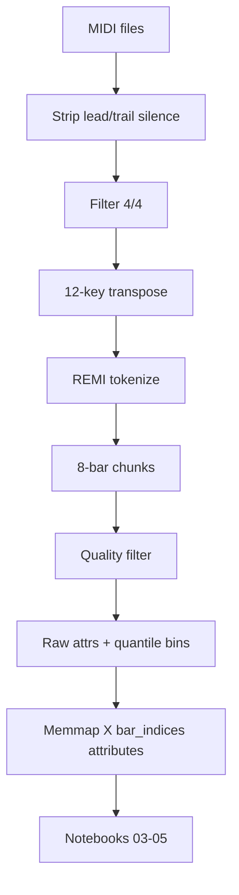
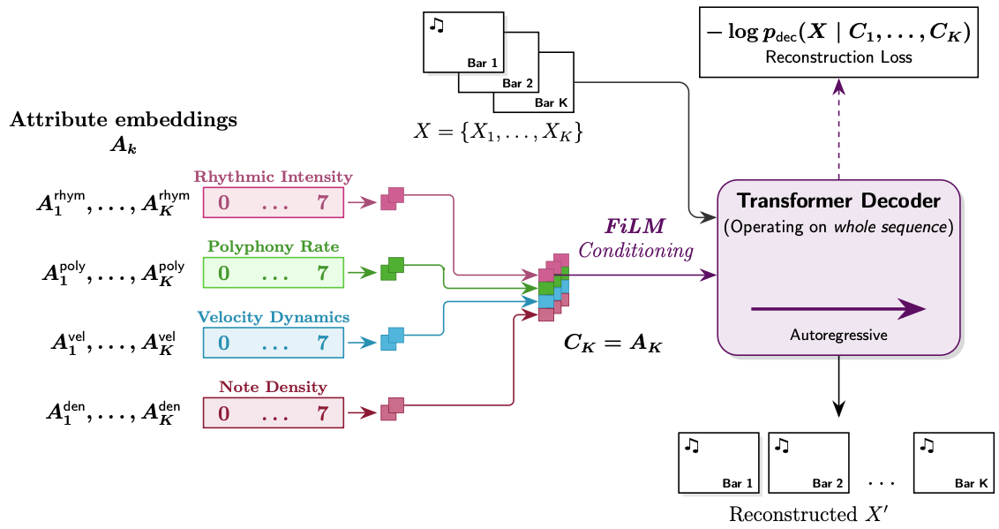
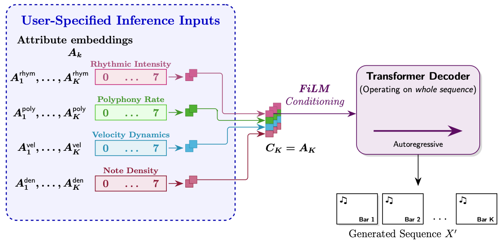
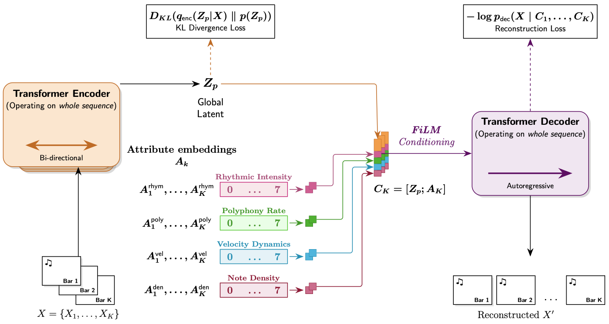
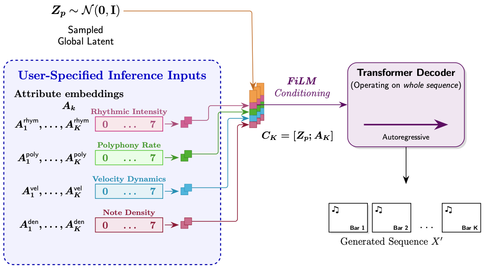
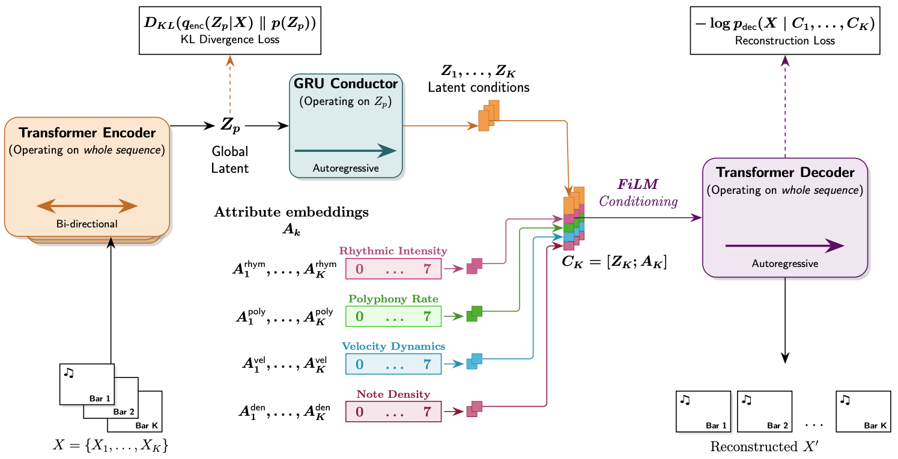
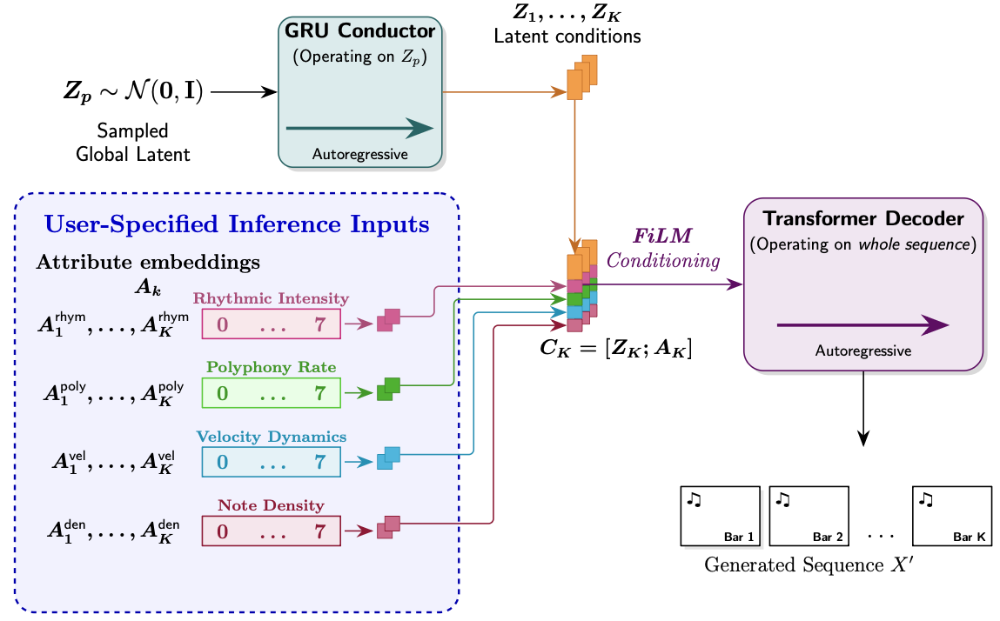
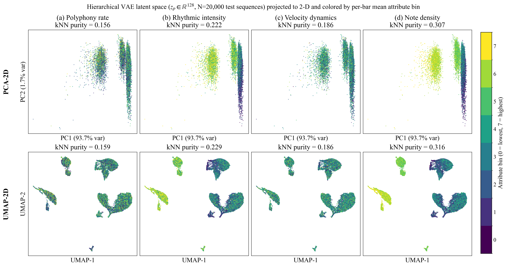

# Cursor Project Summary — Music Generation VAE

**Generated:** 2026-05-29  
**Purpose:** Primary context document for the Gemini gem described in `gem.md`. Use this alongside `technical-specification.md`, `piano-music-generative-models.md`, and `docs/paper-claims-ledger.md`.  
**Rebuild PDF:** See Section 0 at end of this file.

**Author context:** CPSC 440 project (UBC) → portfolio / LinkedIn research write-up. Compare three generative architectures for **controllable symbolic classical piano** under strict Kaggle GPU limits.

---

## How to Use This Document

| If you are writing… | Read… |
|---------------------|--------|
| §1 Introduction / motivation | §1 narrative + user-polished §1.1–1.3 notes (§10) |
| §2 Architecture | §4 + architecture figures in `docs/` |
| §3 Results (E1–E4) | §6 (verified tables) + §7 interpretation |
| Appendix A (data/tokens) | §2–3 |
| Appendix (implementation) | §8 file index |
| Any numeric claim | §6 + `docs/paper-claims-ledger.md` — **do not invent numbers** |

**Primary E3 story (fixed):** Attribute-regime clusters (notebooks `022`/`023`), **not** MidiBERT embeddings. MidiBERT/HDBSCAN/cosine variants are secondary (Appendix F only).

---

## 1. Narrative Spine

1. **Problem:** Generate coherent 8-bar classical piano MIDI with user control over texture, rhythm, dynamics, and density.
2. **Representation:** REMI tokens (195 vocab), fixed 1024 length, explicit `Bar` boundaries.
3. **Control:** Four bar-wise attributes binned 0–7 (`A_k`), embedded and injected via **FiLM** at every decoder layer.
4. **Three models (increasing capacity):**
   - **Plain Transformer** — attributes only (baseline).
   - **Simple VAE** — global latent `z_p` + attributes.
   - **Hierarchical VAE** — `z_p` → GRU **conductor** → per-bar `z_k` + attributes.
5. **Training:** Kaggle T4 GPU(s), mixed precision, memmap streaming, cyclical β + KL free bits for VAEs.
6. **Findings:** Hierarchical VAE best test perplexity; all models controllable; plain/simple win exact-bin accuracy; hierarchical wins monotonic control (Pearson *r*) and partial μ organization vs attribute clusters.

---

## 2. Repository Map

```
project/
├── technical-specification.md    # Ground-truth system design (may have stale checkpoint table)
├── piano-music-generative-models.md # Full paper draft in repo
├── gem.md                          # Gemini gem instructions
├── cursor_summary.md / .pdf        # This document
├── docs/                           # Report figures + paper-claims-ledger.md
├── ml/
│   ├── src/musicgen/
│   │   ├── models/                 # plain_transformer.py, simple_vae.py, vae.py
│   │   ├── preprocess/             # tokenize, attributes, chunking stubs
│   │   ├── inference/              # generate.py, grammar.py, tokenizer, API helpers
│   │   ├── analysis/               # control_eval.py, latent_space_viz.py
│   │   └── eval/                   # attribute recomputation for E2
│   └── scripts/
│       ├── preprocess_all.py       # Full preprocessing → memmap
│       └── plot_latent_organization_bert.py
├── kaggle/notebooks/
│   ├── 03_plain_transformer_dev.ipynb
│   ├── 04_vae_dev.ipynb              # Hierarchical VAE + β schedule
│   ├── 05_simple_vae_dev.ipynb
│   ├── 08_eval_recon_kl.ipynb
│   ├── 08_eval_all_combined.ipynb    # E1 + E2
│   ├── 022_latent_space_vae_attr.ipynb   # E3 primary (hierarchical)
│   └── 023_latent_space_simple_attr.ipynb # E3 primary (simple)
├── artifacts/
│   ├── preprocessed_memmap/{train,val,test}/  # Production data
│   ├── eval/original/              # e1_recon_kl.json, e2_controllability.json
│   └── eval/latent_vis_*_attr/     # E3/E4 attribute-cluster runs
├── web/                            # MusicGen dashboard (GitHub Pages)
├── services/inference_api/         # FastAPI + optional ONNX
└── report.tex                      # LaTeX TikZ architecture (source for some diagrams)
```

**Dashboard:** https://kshoker12.github.io/Music-Generation-VAE/  
**GitHub:** https://github.com/kshoker12/Music-Generation-VAE

---

## 3. Data Pipeline (Implementation)

### 3.1 Sources and credits

| Dataset | Role | Citation |
|---------|------|----------|
| **MAESTRO** | High-quality performance MIDI (~200h filtered in spec) | Hawthorne et al., 2019 — arXiv:1810.12247 |
| **GiantMIDI-Piano** | Large-scale classical piano (~300h curated in spec) | Kong et al., 2020 — arXiv:2010.07393 |

GiantMIDI curation (per spec): preferred composers (Beethoven, Chopin, Liszt, etc.) + keywords (sonata, nocturne, etude, …). Combined source material ≈ **500 hours** before chunking; after **12-key transposition** and filters the spec cites ≈6,000 equivalent hours of pitch-diverse data.

### 3.2 Preprocessing steps (`ml/scripts/preprocess_all.py`)

1. **Parse MIDI** → strip **leading and trailing** silence at piece level.
2. **Time signature filter:** Keep 4/4 and equivalent (2/4, 2/2). `use_time_signatures=False` at tokenization.
3. **12-key transposition** at piece level (pitch range 21–108); discard invalid keys.
4. **REMI tokenize** (`miditok`).
5. **8-bar chunking** on `Bar` token boundaries.
6. **Length fix:** Truncate or pad to **1024** tokens (`BLOCK_SIZE`).
7. **Chunk quality filter** (`chunk_passes_filter`) — drop unless ALL hold:
   - ≥ **6/8** bars with `note_density > 0`
   - ≥ **40** total onsets across chunk
   - ≤ **1** leading empty bar (drop if ≥2 prefix empty bars)
   - Mean **rhythmic_intensity** ≥ **0.10**
8. **Raw per-bar attributes** from tokens (see §3.3).
9. **Quantile binning:** Fit **8-bin edges on training bars only** (from filtered chunks); apply to all splits. Save `artifacts/attributes/quantiles.json`.
10. **Memmap export** per split.

### 3.3 Attribute definitions (raw, before binning)

Computed in `compute_raw_attributes_per_bar_from_tokens` for each of 8 bars:

| Index | Name | Formula (intuitive) |
|-------|------|---------------------|
| 0 | **polyphony_rate** | Mean over 16 position slots of simultaneous active notes (interval overlap count), ∈ [0, max polyphony] |
| 1 | **rhythmic_intensity** | `(# distinct position slots with onset) / 16` |
| 2 | **velocity_dynamics** | Std dev of velocity values in bar (0 if no notes) — **variation in loudness**, not mean volume |
| 3 | **note_density** | Count of note onsets in bar |

**Notation:** Per-bar binned controls are **A_k** ∈ {0,…,7}⁴ for bar index k ∈ {0,…,7}. Stored as `attributes` tensor shape `[N, 8, 4]` (uint8).

### 3.4 Train / val / test scale

| Split | Examples | Bars (×8) | Source |
|-------|----------|-----------|--------|
| Train | **1,430,251** | 11,442,008 | `artifacts/preprocessed_memmap/train/meta.json` |
| Val | **20,135** | 161,080 | `.../val/meta.json` |
| Test | **21,105** | 168,840 | `.../test/meta.json` |

Split policy: **80/10/10** (spec). Block size **1024**, **8 bars** per example, vocab **195**.

### 3.5 Memmap schema (Kaggle-optimized)

| Array | Shape | dtype | Role |
|-------|-------|-------|------|
| `X.u16.memmap` | [N, 1024] | uint16 | Token IDs |
| `bar_indices.u8.memmap` | [N, 1024] | uint8 | Bar index 0..7 per token |
| `attributes.u8.memmap` | [N, 8, 4] | uint8 | Binned attributes per bar |

**Targets `Y` are NOT stored.** Training computes `Y = shift(X)` with `pad_id` at final position (halves storage).

**Why memmaps:** DataLoader memory-maps slices from disk — essential when N > 10⁶ and RAM is 16 GB on Kaggle.

### 3.6 Data flow diagram



---

## 4. Tokenization (REMI)

- **Library:** `miditok` REMI tokenizer.
- **Vocab size:** **195** tokens.
- **Special tokens:** `Bar_None` (bar_id=2), `PAD_None` (pad_id=0), `BOS_None`.
- **Use `Bar` in prose, not `<BAR>`** — angle brackets are for PAD/BOS only.

### 4.1 Vocabulary table

| Family | Count | Examples / role |
|--------|------:|-----------------|
| Special | 3 | BOS, Bar, PAD |
| Position | 16 | `Position_0` … `Position_15` (4/4 bar slots) |
| Pitch | 88 | Piano keys 21–108 |
| Velocity | 32 | Dynamics bins |
| Duration | 24 | Note length in beats (sustain folded in) |
| Tempo | 32 | Tempo changes |
| **Total** | **195** | |

### 4.2 Tokenizer config (spec)

```python
TokenizerConfig(
    pitch_range=(21, 108),
    beat_res={(0, 4): 4, (4, 8): 2},
    num_velocities=32,
    use_time_signatures=False,
    use_sustain_pedals=False,  # folded into Duration
    use_tempos=True,
)
```

### 4.3 Sequences and bar indexing

- Training sequence: **X = (x₁, …, x_T)** with **T = 1024**.
- `bar_indices[b, t]` maps token t to bar k for broadcasting **A_k** (and **z_k** in hierarchical model).
- On each generated **`Bar`** token, `compute_bar_indices_prefix` in `generate.py` advances the bar counter so FiLM switches to the next bar's condition vector.

---

## 5. Three Architectures

Shared decoder: **6-layer causal Transformer** with **FiLM** before self-attention in each block:

$$\tilde{h} = h \odot (1 + \gamma) + \beta$$

where γ, β are linear projections of the per-token condition vector.

### 5.1 Plain Transformer (`ml/src/musicgen/models/plain_transformer.py`)

| Item | Detail |
|------|--------|
| Latent | None |
| Condition | **A_k** only → embed to 128-D/bar → broadcast via `bar_indices` |
| Training loss | PAD-masked cross-entropy |
| Params | ~22.8M (decoder only) |
| Checkpoint (E1/E2) | **plain_v3** |

**Training:** `C_k = embed(A_k)` broadcast to all tokens in bar k.

**Inference:** User supplies `attributes` [1, 8, 4]; grammar-masked autoregression.



*Figure: Plain model training — attribute embeddings → FiLM decoder; no encoder.*



*Figure: Plain inference — user attributes + grammar decoding only.*

### 5.2 Simple VAE (`ml/src/musicgen/models/simple_vae.py`)

| Item | Detail |
|------|--------|
| Encoder | 6-layer **bidirectional** Transformer + learned **[CLS]** → μ, log σ² ∈ ℝ¹²⁸ |
| Latent | Global **z_p** ~ q(z|x) via reparameterization |
| Condition | **[z_p ; A_k]** → 256-D broadcast (128 + 128) |
| ELBO | recon + β · KL (free bits) |
| Params | ~42.4M |
| Checkpoint | **simple_v2** |

**Training:** Sample z_p; broadcast same z_p to all bars (no conductor).



*Figure: Encoder compresses sequence to z_p; attributes per bar; FiLM decoder.*



*Figure: Sample z_p ~ N(0,I) or use encoder; fixed attributes per bar.*

### 5.3 Hierarchical VAE (`ml/src/musicgen/models/vae.py`)

| Item | Detail |
|------|--------|
| Encoder | Same as simple → **z_p** ∈ ℝ¹²⁸ |
| Conductor | 2-layer **GRU**, hidden 384 → **z_k** ∈ ℝ³⁸⁴ per bar |
| Condition | **C_k = [z_k ; A_k]** ∈ ℝ⁵¹² (3:1 ratio z:attributes) |
| Params | ~44.3M total (~19.6M enc + ~1.9M cond + ~22.8M dec) |
| Checkpoint | **vae_v3** |

**Forward (training):**
1. μ, logvar = Encoder(X)
2. z_p = reparameterize(μ, logvar)
3. z_k = Conductor(z_p)  # [B, 8, 384]
4. A_k = AttributeEmbedder(attributes)  # [B, 8, 128]
5. C_k = concat(z_k, A_k)  # [B, 8, 512]
6. cond_tok = broadcast(C_k, bar_indices)  # [B, 1024, 512]
7. logits = FiLMDecoder(X, cond_tok)



*Figure: Encoder → z_p → GRU conductor → per-bar z_k; concat A_k; FiLM decoder.*



*Figure: Sample z_p; conductor expands to 8 bar conditions; autoregressive decode.*

### 5.4 VAE training objectives

**Reconstruction:** PAD-masked CE on next-token prediction.

**KL with free bits** (`kl_divergence_free_bits`, λ = **1.0 bit/dim**):
- Per-dimension KL averaged over batch, then hinge at λ nats before summing.
- Prevents posterior collapse to zero.

**Cyclical β-annealing** (hierarchical notebook `04_vae_dev.ipynb`):
- Cycle length **10,000** optimizer steps.
- β ramps **0 → 0.1** over first **5,000** steps, holds **0.1** for second 5,000.
- Periodically reintroduces KL after reconstruction-focused phases.

**ELBO:** \(\mathcal{L} = \mathcal{L}_{\text{recon}} + \beta \cdot \mathcal{L}_{\text{KL}}\)

---

## 6. Training and Checkpoints

### 6.1 Notebook index

| Notebook | Purpose |
|----------|---------|
| `03_plain_transformer_dev.ipynb` | Train plain baseline |
| `04_vae_dev.ipynb` | Train hierarchical VAE |
| `05_simple_vae_dev.ipynb` | Train simple VAE |
| `08_eval_recon_kl.ipynb` | E1 reconstruction + KL |
| `08_eval_all_combined.ipynb` | E1 + E2 combined |
| `022_latent_space_vae_attr.ipynb` | E3/E4 hierarchical (primary) |
| `023_latent_space_simple_attr.ipynb` | E3/E4 simple (primary) |

Latent exploration notebooks `010`–`021` exist for ablations (MidiBERT, HDBSCAN, cosine, etc.) — **secondary** for main paper.

### 6.2 Hyperparameters (production)

| Setting | Value |
|---------|-------|
| Optimizer | AdamW, lr=3×10⁻⁴, weight decay=0.01 |
| LR schedule | Cosine to 10⁻⁵ |
| Micro-batch | 8 |
| Gradient accumulation | 2 → **effective batch 16** |
| Precision | FP16 + GradScaler on CUDA |
| Block size | 1024 |
| Hardware | Kaggle **T4 16 GB** (user portfolio text: T4×2; spec sometimes says single T4) |

### 6.3 Production checkpoints (Section 3 eval)

| Model | Slug | Block | ~Steps | Kaggle path pattern |
|-------|------|-------|--------|---------------------|
| Plain | plain_v3 | 1024 | ~50k | `plain_v3/ckpt.pt` |
| Simple VAE | simple_v2 | 1024 | — | `simple_v2/ckpt.pt` |
| Hierarchical VAE | vae_v3 | 1024 | ~50k | `vae_v3/ckpt.pt` |

---

## 7. Evaluation Protocols and Verified Results

### 7.1 E1 — Reconstruction (test, teacher forcing)

**Protocol:** PAD-masked CE on test memmap; PPL = exp(CE). VAEs report total KL in **bits per sample** (128-D latent). **200 batches**, ~1.58M tokens.

**Source:** `artifacts/eval/original/e1_recon_kl.json`

| Model | Checkpoint | CE | PPL | KL (bits/sample) |
|-------|------------|-----|-----|------------------|
| Plain Transformer | plain_v3 | 1.693 | **5.512** | — |
| Simple VAE | simple_v2 | 1.695 | 5.519 | 100.2 |
| **Hierarchical VAE** | **vae_v3** | **1.678** | **5.427** | 110.0 |

**Interpretation:** Hierarchical VAE has **lowest perplexity**. KL ~100–110 bits/sample (~0.78–0.86 bits/dim) → **active latent use**, not collapse. Plain has no KL but is not better on NLL.

### 7.2 E2 — Attribute controllability

**Protocol:**
- For each of 4 attributes, sweep requested bin **0–7**.
- Other three attributes fixed at bin **3**.
- Autoregressive generation with grammar masking; recompute raw stats from output tokens; map to bins via **global training quantiles**.
- Metrics: **exact-bin accuracy**, **±1-bin accuracy**, **Pearson r** (requested bin vs raw statistic).

**Source:** `artifacts/eval/original/e2_controllability.json`

#### Summary (mean over 4 attributes)

| Model | Exact-bin | ±1-bin | Pearson r |
|-------|-----------|--------|-------------|
| Plain | **0.898** | 0.945 | 0.826 |
| Simple | **0.894** | 0.966 | 0.853 |
| Hierarchical | 0.525 | **0.992** | **0.943** |

#### Per-attribute exact-bin accuracy

| Attribute | Plain | Simple | Hierarchical |
|-----------|-------|--------|--------------|
| Polyphony Rate | 0.906 | 0.904 | 0.650 |
| Rhythmic Intensity | 0.948 | 0.904 | 0.342 |
| Velocity Dynamics | 0.990 | 0.981 | 0.317 |
| Note Density | 0.750 | 0.788 | 0.792 |

**Interpretation:**
- **FiLM works** for all models (±1-bin ≥ 94%).
- **Plain/Simple** win **exact-bin** (especially rhythm, velocity).
- **Hierarchical** trades exact-bin for **smoothest monotonic control** (highest Pearson r); best on note density correlation (0.94).
- Note density is hardest for plain/simple at exact-bin.

### 7.3 E3 — Latent space structure (PRIMARY)

**Ground-truth clusters (not composer labels):**
1. Per test example: **mode** of each attribute across 8 bars → 4-D bin vector.
2. Subsample **20,000** test examples.
3. **IsolationForest** outlier removal (~399 outliers).
4. **K-means k=4** on 4-D attribute vectors (silhouette/CH/DB vote → k=4).

**Encoder side:**
- Encode **μ** (128-D) from test sequences (not sampled z).
- Project with PCA and UMAP (2-D).
- **kNN purity** (k=15): fraction of neighbors sharing same cluster label.
- **NMI / ARI** between K-means on μ and attribute clusters.
- Random purity baseline for k=4: **0.25**.

**Sources:** `artifacts/eval/latent_vis_vae_attr/`, `latent_vis_simple_attr/`; notebooks 022, 023.

| Model | kNN purity (PCA) | kNN purity (UMAP) | NMI | ARI |
|-------|------------------|-------------------|-----|-----|
| **Hierarchical (vae_v3)** | **0.374** | **0.382** | **0.206** | **0.112** |
| Simple (simple_v2) | 0.293 | 0.363 | 0.047 | 0.044 |
| Plain | — | — | — | — (no μ) |



*Figure: E3 UMAP/PCA visualization (docs asset for portfolio report).*


*Figure: Encoder μ colored by attribute-regime clusters (k=4). Left: hierarchical VAE; right: simple VAE. **Primary Figure for §3.3.***

**Do NOT claim in main paper:**
- MidiBERT clusters as primary E3 story
- Composer/mood clusters (not evaluated as primary)
- Self-BLEU diversity
- Clean disentanglement of μ from attributes (FiLM already injects attributes)

### 7.4 E4 — Local latent perturbation (brief)

**Neighborhood test:** Perturb μ with Gaussian noise (σ ∈ {0.1, 0.25, 0.5, 1.0}); check if K-means cluster label unchanged.

| Model | Cluster preservation rate |
|-------|---------------------------|
| Hierarchical | **81.25%** (520/640) |
| Simple | **74.22%** (475/640) |

**SLERP interpolation:** Linear interpolate μ between two cluster centroids; **rarely** lands in target cluster at t=1.0 (hierarchical 1/10, simple 2/10).

**Sources:** `e4_neighborhood_clusters.json`, `e4_interp_clusters.json` in `latent_vis_*_attr/`.

### 7.5 Training attribute distribution


*Figure: Distribution of binned attributes on training data after quantization (4 attributes × 8 bins).*

---

## 8. Results Interpretation Guide (for Gemini)

### 8.1 Headline bullets (safe to use)

1. **Best reconstruction:** Hierarchical VAE test PPL **5.427** vs 5.512–5.519 baselines (E1).
2. **Controllable generation:** All models achieve high ±1-bin attribute accuracy; hierarchical has best **Pearson r** (~0.94 mean).
3. **Exact-bin trade-off:** Plain/Simple ~90% mean exact-bin; Hierarchical ~53% but smoother control.
4. **Latent organization:** Hierarchical μ shows **partial** alignment with attribute-regime clusters (NMI ≈ 0.21, purity ≈ 0.37); Simple μ near random (NMI ≈ 0.05).
5. **VAE mitigations worked:** KL ~100+ bits/sample with free bits + cyclical β — not posterior collapse.

### 8.2 Claim → evidence table

| Claim | Evidence file |
|-------|----------------|
| Train 1.43M examples | `artifacts/preprocessed_memmap/train/meta.json` |
| E1 PPL table | `artifacts/eval/original/e1_recon_kl.json` |
| E2 controllability | `artifacts/eval/original/e2_controllability.json` |
| E3 kNN/NMI | `latent_vis_vae_attr/e3_knn_purity_clusters.json`, `latent_vis_simple_attr/...` |
| FiLM formula | `ml/src/musicgen/models/vae.py` FiLMBlock |
| β schedule | `kaggle/notebooks/04_vae_dev.ipynb` |
| Checkpoints plain_v3, simple_v2, vae_v3 | `docs/paper-claims-ledger.md` |

### 8.3 Spec / doc contradictions (resolve with user)

| Topic | Note |
|-------|------|
| GPU | Spec: single T4 16GB; user §1.1: **T4×2** — align in hardware paragraph |
| Checkpoint table in spec | May list v4/v1 runs; **Section 3 uses v3/v2 @ 1024 only** |
| `piano-music-generative-models-final.md` | Referenced in gem.md but **not in repo**; use `piano-music-generative-models.md` |
| Velocity attribute wording | Must be **variation** (std), not mean loudness |
| Token name | **`Bar`** not `<BAR>` |

### 8.4 Do not claim

- Self-BLEU
- Composer-colored E3 in main results
- GRL adversarial disentanglement (future work)
- MCTS decoding (future work)
- MidiBERT as primary E3 narrative

---

## 9. Inference and Deployment

### 9.1 Generation (`ml/src/musicgen/inference/generate.py`)

- Grammar-constrained decoding (`grammar.py`) enforces valid REMI token sequences.
- `bar_indices` recomputed from prefix including generated `Bar` tokens.
- VAEs: sample `z_p ~ N(0,I)` or pass fixed latent; hierarchical runs conductor each forward.
- Stops before 9th bar (8 bars max).

### 9.2 Web dashboard (`web/`)

Interactive UI: select model, attribute bins per bar, temperature, top-p, seed → MIDI/audio preview.

### 9.3 Inference API (`services/inference_api/`)

FastAPI service; optional ONNX path in `onnx_io.py`. See `services/inference_api/README.md`.

---

## 10. User Conversation Notes (Paper Polish)

**§1.3 dataset section (user draft, review fixes):**
- Use **`Bar`** token name, not `<BAR>`.
- 12-key transposition → **pitch/key coverage**, not "harmonic diversity."
- Silence: **leading and trailing** at piece level; chunk filter for leading empty bars.
- Avoid hype words ("rigorously," "seamlessly"); keep tone like §1.1–1.2.

**§1.2 attributes:**
- Velocity dynamics = **how much loudness varies within a bar** (std).
- Rhythmic intensity = fraction of rhythmic slots with onsets.

**E3:** Primary = attribute-regime clusters (022/023). Filename `latent_organization_bert_attr_k4.png` is historical; **not** MidiBERT in primary eval.

**Tone (gem.md):** Precise, intuitive, no fluff; respect reader time; portfolio for UBC grad 2027 job search.

---

## 11. Implementation File Index

| Path | Role |
|------|------|
| `ml/scripts/preprocess_all.py` | Full MIDI→memmap pipeline, chunk filter, attribute compute, quantiles |
| `ml/src/musicgen/models/vae.py` | Hierarchical VAE: encoder, conductor, FiLM decoder, KL free bits |
| `ml/src/musicgen/models/simple_vae.py` | Simple VAE: global z broadcast |
| `ml/src/musicgen/models/plain_transformer.py` | Attribute-only baseline |
| `ml/src/musicgen/inference/generate.py` | Autoregressive generation + bar index tracking |
| `ml/src/musicgen/inference/grammar.py` | REMI grammar mask |
| `ml/src/musicgen/inference/tokenizer.py` | Load miditok, vocab IDs |
| `ml/src/musicgen/analysis/control_eval.py` | E2 metric helpers, attribute display names |
| `ml/src/musicgen/analysis/latent_space_viz.py` | E3 clustering, UMAP, purity |
| `ml/scripts/plot_latent_organization_bert.py` | Side-by-side latent PNG plots |
| `kaggle/notebooks/08_eval_all_combined.ipynb` | Canonical E1/E2 reproduction |
| `kaggle/notebooks/022_*.ipynb`, `023_*.ipynb` | Canonical E3/E4 attribute runs |
| `artifacts/attributes/quantiles.json` | Global bin edges |
| `tokenizer_meta.json` | id↔token string map |
| `technical-specification.md` | Full architecture + math spec |
| `piano-music-generative-models.md` | In-repo paper draft |
| `docs/paper-claims-ledger.md` | Verified numbers index |
| `report.tex` | LaTeX report with TikZ diagrams |

---

## 12. Paper Section Mapping

| Paper § | Content source | Figures |
|---------|----------------|---------|
| 1.1 Motivation | User draft + §1 | — |
| 1.2 Musical background | User draft | — |
| 1.3 Data / preprocessing | User draft + §3–4 | — |
| 1.4 Related work | musemorphose, music_vae, emo_music_tv, film papers | — |
| 2 Architecture | §5 + `docs/*.png` | 6 architecture PNGs |
| 3.1 E1 | §7.1 | — |
| 3.2 E2 | §7.2 | — |
| 3.3 E3 | §7.3 | `e3_latent_visualization.png`, `latent_organization_bert_attr_k4.png` |
| 3.4 Samples | Dashboard + listening notes | — |
| Appendix A | §3–4 | token table |
| Appendix F | §7.3 optional list below | secondary E3 PNGs |

### 12.1 Secondary E3 assets (list only — do not all embed)

| File | Description |
|------|-------------|
| `artifacts/eval/latent_organization_bert_k4.png` | MidiBERT embedding clusters |
| `artifacts/eval/latent_organization_bert_cos_k4.png` | Cosine similarity clusters |
| `artifacts/eval/latent_organization_bert_dbscan_k13.png` | DBSCAN on MidiBERT |
| `artifacts/eval/latent_organization_bert_final_k4.png` | MidiBERT → UMAP(5D) pipeline |
| `artifacts/eval/latent_organization_k4.png` | Raw μ k-means (no attribute GT) |

---

## 13. Related Papers (gem file context)

| Paper | Tie-in |
|-------|--------|
| **MusicVAE** (Roberts et al., 2018) | Hierarchical global→local latents; we use GRU conductor + Transformer decoder |
| **MuseMorphose** (Wu & Yang, 2021) | Transformer VAE for piano; we use **FiLM** instead of in-attention conditioning |
| **EmoMusicTV** (Ji & Yang, 2024) | Hierarchical Transformer VAE with labels; our bins are **performance statistics** |
| **FiLM** (Perez et al., 2018) | Feature-wise modulation in decoder |
| **Attention Is All You Need** (2017) | Causal decoder backbone |
| **VAE** (Kingma & Welling, 2014) | ELBO, reparameterization |

---

## 0. Rebuild PDF from This Markdown

```bash
cd "/Users/kshoker/Desktop/CPSC 440/project"

pandoc cursor_summary.md -o cursor_summary.html \
  --standalone --embed-resources --toc \
  --resource-path=".:docs:artifacts/eval"

"/Applications/Google Chrome.app/Contents/MacOS/Google Chrome" \
  --headless --disable-gpu \
  --no-pdf-header-footer \
  --print-to-pdf="$(pwd)/cursor_summary.pdf" \
  "file://$(pwd)/cursor_summary.html"
```

If Chrome headless fails: open `cursor_summary.html` in a browser → Print → Save as PDF.

---

*End of Cursor Project Summary.*
