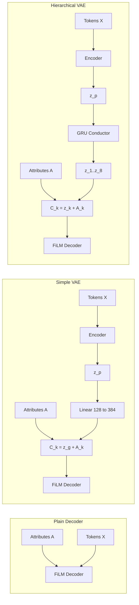

# Piano Music Generative Models

**Exploring Generative Models for Controllable Symbolic Piano Music Generation (Plain Transformer, VAE, and Hierarchical VAE)**

**Karandeep Shoker**  
[LinkedIn](https://www.linkedin.com/in/kshoker12/)

### Quick Access

- **[MusicGen Dashboard](https://kshoker12.github.io/Music-Generation-VAE/)** — Interactive UI to generate 8-bar piano excerpts with controllable attributes. *Try this first if you want to hear the models.*
- **[GitHub Repo](https://github.com/kshoker12/Music-Generation-VAE)** — Kaggle training notebooks, preprocessing, and inference logic
- **Architecture diagrams (LaTeX/TikZ):** [report.tex](report.tex)
- **Verified numbers index:** [docs/paper-claims-ledger.md](docs/paper-claims-ledger.md)

---

## Abstract

This project compares three increasingly expressive generative architectures for **controllable symbolic piano music**: a **Plain Transformer** decoder (attributes only), a **Simple VAE** (global latent plus attributes), and a **Hierarchical VAE** (global latent expanded to per-bar latents via a GRU conductor, plus attributes). All models share the same FiLM-conditioned causal Transformer decoder and are trained on 8-bar REMI token sequences with four user-facing control knobs—Polyphony Rate, Rhythmic Intensity, Velocity Dynamics, and Note Density—each quantized to eight global levels.

Models were trained on Kaggle T4 GPUs with mixed precision. On a held-out test split, the **hierarchical VAE achieves the lowest reconstruction perplexity** (5.43 vs. 5.51–5.52 for baselines) while using a structured 128-dimensional global latent regularized by cyclical β-annealing and KL free bits. **Attribute controllability** is strong for all models on coarse bins (±1-bin accuracy ≥94%); the plain and simple models lead on **exact-bin** accuracy (~90%), whereas the hierarchical VAE shows the **strongest monotonic correlation** between requested bins and measured statistics (mean Pearson *r* ≈ 0.94). **Latent-space organization** is evaluated by clustering test examples in attribute space and measuring alignment in encoder mean μ: the hierarchical model shows **partial alignment** (kNN purity 0.38, NMI 0.21) while the simple VAE latent remains largely unorganized (NMI 0.05). An interactive dashboard and curated generated samples complement the quantitative evaluation.

---

## 1 Introduction

### 1.1 Motivation

Generative models for music must balance two goals: **faithful learning** from data and **controllable generation** at inference time. Symbolic piano MIDI offers a compact, editable representation well suited to sequence models, but long-range coherence and user-facing controls are hard to achieve with limited compute.

This work began as a CPSC 440 project and grew into a full pipeline: preprocessing large classical-piano corpora, training three model families on Kaggle, and evaluating reconstruction, controllability, and latent structure with reproducible notebooks. The central question is practical rather than purely theoretical: *given a single GPU budget, what architectural choices buy controllable, coherent 8-bar generation?*

We study (i) **decoder-only conditioning** on quantized attributes, (ii) a **standard VAE** with a global latent, and (iii) a **hierarchical VAE** inspired by MusicVAE and MuseMorphose—adding a conductor that maps one global code to eight bar-level instructions. Along the way we implement standard **posterior-collapse mitigations** (cyclical β-annealing, KL free bits, and repeated FiLM injection) and report where they succeed and where they do not.

### 1.2 Musical Background

**Symbolic piano generation.** We generate discrete **REMI token sequences** that can be detokenized to MIDI and rendered to audio. Each training example is a fixed **8-bar excerpt** in **4/4 time**, giving predictable bar boundaries and a `<Bar>` token that marks measure transitions.

**Datasets.** We combine **MAESTRO** (high-quality performance MIDI) and **GiantMIDI-Piano** (large-scale classical piano), filtered and curated as described in Section 1.4. Together they provide on the order of **500 hours** of source material before chunking and augmentation (see technical specification).

**REMI tokenization.** REMI (Revamped MIDI) encodes pitch, duration, velocity, and temporal position within each bar—closer to sheet music than raw millisecond streams. Our vocabulary has **195 tokens** (see Appendix A). Sequences are denoted \(X = (x_1, \ldots, x_T)\) with \(T = 1024\).

**Controllable attributes.** Four **bar-wise** statistics—computed from tokens and stored as bins 0–7—act as explicit control knobs at inference:

| Attribute | Meaning (intuitive) |
|-----------|---------------------|
| **Polyphony Rate** | How thick the texture is (simultaneous notes) |
| **Rhythmic Intensity** | How active the rhythm is within the bar |
| **Velocity Dynamics** | How much loudness varies (expressive dynamics) |
| **Note Density** | How many note onsets occur per bar |

Each bar \(k\) has an attribute vector \(A_k \in \{0,\ldots,7\}^4\), embedded and fed to the decoder (Section 2).

### 1.3 Related Work

**MusicVAE (Roberts et al., 2018)** introduced hierarchical latents for long-form music. We adopt the *idea* of a global bottleneck expanded temporally, but target **8-bar piano chunks** with **FiLM** rather than their original RNN setup.

**MuseMorphose (Wu & Yang, 2021)** uses a Transformer VAE with **in-attention** conditioning (adding a condition vector into attention). We instead apply **FiLM affine modulation** on hidden states before self-attention at **every decoder layer**, which scales and shifts representations rather than only biasing attention—stronger enforcement of bar-level conditions in our setting.

**EmoMusicTV (Ji & Yang, 2024)** combines hierarchical Transformer VAEs with emotion labels. Our attribute bins play an analogous conditioning role but are **performance statistics** (density, velocity, etc.) rather than emotion categories.

**FiLM (Perez et al., 2018)** provides feature-wise linear modulation \(\tilde{h} = h \odot (1+\gamma) + \beta\) from a condition vector. We use FiLM as the **shared conditioning mechanism** across all three architectures.

**Attention Is All You Need (Vaswani et al., 2017)** underpins our causal decoder; the encoder is a **bidirectional** Transformer (BERT-style) with a `[CLS]` token for VAE variants.

### 1.4 Dataset, Preprocessing, and Tokenization

**Pipeline overview.**

1. Filter pieces to **4/4** (and equivalent 2/4, 2/2) time signatures.
2. Strip leading/trailing silence; slice into **8-bar chunks**.
3. Apply **chunk-quality filters** (minimum active bars, minimum onsets, rhythmic activity).
4. **12-key transposition** augmentation at the piece level (pitch-invariant attributes).
5. Tokenize with REMI; pad or drop to **1024 tokens**.
6. Compute raw per-bar attributes; **quantize to 8 bins** using global training quantiles.
7. Store as **memory-mapped arrays** for Kaggle streaming (`X`, `bar_indices`, `attributes`; targets `Y` derived as a shift of `X` at train time).

**Dataset scale (after preprocessing).**

| Split | Examples | Bars (×8) |
|-------|----------|-------------|
| Train | 1,430,251 | 11,442,008 |
| Validation | 20,135 | 161,080 |
| Test | 21,105 | 168,840 |

Attribute bins are fit on filtered training bars; marginals are approximately uniform by design, with some skew in rhythmic intensity on the full train memmap (see Appendix F).

**Notation.** Token sequences \(X_{1:T}\); per-bar attribute bins \(A_{1:K}\) with \(K=8\); bar index map `bar_indices` aligns each token with its measure.

Detailed REMI vocabulary and filter thresholds are in **Appendix A**.

### 1.5 Statistical Modelling Approach

We compare three generative stories on the same data and attribute interface:

**Plain Decoder.** Autoregressively model \(p(X \mid A)\). Each bar’s attribute embedding is projected to a 512-D FiLM condition; **no latent variables**.

**Simple VAE.** Introduce a **global latent** \(z_p \in \mathbb{R}^{128}\) from a bidirectional encoder (whole sequence → `[CLS]` → \(\mu, \log\sigma^2\)). Sample \(z_p\), project to \(z_g \in \mathbb{R}^{384}\), **broadcast** the same \(z_g\) to all eight bars, and decode with \(C_k = [z_g; A_k]\).

**Hierarchical VAE.** Same encoder and \(z_p\), but a **GRU conductor** deterministically maps \(z_p \rightarrow (z_1,\ldots,z_8)\). Each bar gets its own \(z_k \in \mathbb{R}^{384}\); decode with \(C_k = [z_k; A_k]\). This separates **global identity** from **bar-level variation**.

See [report.tex](report.tex) for TikZ architecture figures.

### 1.6 Paper Overview

**Section 2** describes FiLM conditioning, each architecture (training and inference), posterior-collapse mitigations, and Kaggle training setup. **Section 3** reports reconstruction (E1), attribute controllability (E2), latent structure (E3), and qualitative samples. **Section 4** summarizes findings, limitations, and future work. **Appendices** contain token tables, parameter counts, hyperparameter snapshots, extra figures, and an AI disclosure.

---

## 2 Architecture

This section explains how the three models turn attributes (and optional latents) into REMI token distributions. All variants use a **6-layer causal Transformer decoder** with **512-D** hidden size, **8** heads, and **1024** context length.

### 2.1 Feature-wise Linear Modulation (FiLM)

Following Perez et al. (2018), each decoder block receives a bar-aligned condition vector \(C_k \in \mathbb{R}^{512}\). A linear layer produces **scale** \(\gamma(C_k)\) and **shift** \(\beta(C_k)\) that modulate the layer-normalized hidden state **before** causal self-attention:

\[
\tilde{h} = h \odot (1 + \gamma(C_k)) + \beta(C_k).
\]

Because FiLM is applied at **every layer and timestep**, the model cannot easily ignore conditioning by routing around a single injection point—unlike MuseMorphose-style in-attention **addition** of a condition vector, FiLM applies an **affine transform** to the full hidden representation.

Implementation: `FiLMBlock` in [ml/src/musicgen/models/vae.py](ml/src/musicgen/models/vae.py).

### 2.2 Plain Decoder

**Intuition.** A strong autoregressive Transformer can model piano tokens given explicit attribute knobs alone; this is the **lower bound** on complexity.

**Training.** Minimize PAD-masked cross-entropy: predict \(x_t\) from \(x_{<t}\) and bar-aligned attribute conditions \(\hat{C}_k\) (attributes embedded to 128-D, projected to 512-D for FiLM).

**Inference.** User sets attribute bins per bar (or phased UI: different bins for bars 1–4 vs. 5–8). Autoregressive sampling with grammar masking (valid REMI token sequences) and optional top-*p* / temperature.

**Parameters.** Decoder-scale only (~22.8M; see Appendix C).

### 2.3 Simple VAE

**Intuition.** Add a **global stochastic code** \(z_p\) so sampling different latents yields different musical “ideas” while attributes still steer texture and dynamics.

**Encoder.** Bidirectional Transformer on the full 1024-token sequence; `[CLS]` pooling → \(\mu, \log\sigma^2 \in \mathbb{R}^{128}\); reparameterize \(z_p = \mu + \sigma \odot \epsilon\).

**Decoder conditioning.** \(z_g = \mathrm{Linear}(z_p) \in \mathbb{R}^{384}\), broadcast to all bars; \(C_k = [z_g; A_k]\).

**Loss.** PAD-masked reconstruction plus \(\beta \cdot \mathcal{L}_{\mathrm{KL}}\) with free bits (Section 2.5).

**Inference.** Sample \(z_p \sim \mathcal{N}(0, I)\) (or use encoder \(\mu\) for reconstruction); set attributes; decode.

### 2.4 Hierarchical VAE

**Intuition.** Music varies **within** an 8-bar window. A single broadcast \(z_g\) cannot assign different bar-level instructions; the **conductor** (2-layer GRU, hidden 384) maps \(z_p \rightarrow (z_1,\ldots,z_8)\) deterministically.

**Condition ratio.** \(C_k = [z_k; A_k]\) with \(z_k \in \mathbb{R}^{384}\) and \(A_k \in \mathbb{R}^{128}\)—a fixed **3:1** split that biases capacity toward latent contour over attribute knobs (inductive bias, not proven disentanglement).

**Inference.** Sample \(z_p\); conductor expands to per-bar \(z_k\); combine with user attributes; autoregressive decode with `<Bar>`-triggered condition switches.

**Parameters.** ~44.3M total (encoder ~19.6M, conductor ~1.9M, decoder ~22.8M; Appendix C).

### 2.5 Posterior Collapse Mitigation Strategies

**Posterior collapse** occurs when a powerful decoder ignores \(z_p\) and the KL term vanishes—the latent carries no information.

We use three complementary mechanisms:

1. **Cyclical β-annealing.** \(\mathcal{L} = \mathcal{L}_{\mathrm{recon}} + \beta \mathcal{L}_{\mathrm{KL}}\) with \(\beta\) cycling from 0 to **0.1** over **10,000 optimizer steps** (5,000-step ramp, 5,000-step hold), repeating across training. Low-β phases prioritize reconstruction; high-β phases re-impose prior pressure.

2. **KL free bits.** Per latent dimension, hinge batch-mean KL at **λ = 1.0 bit** before summing over 128 dimensions—preventing collapse to zero KL on unused dimensions.

3. **Repeated FiLM conditioning.** Combined with the 3:1 \(z_k{:}A_k\) ratio, latents remain a visible signal at every layer.

These strategies yield **non-trivial KL** (~0.78–0.86 bits/dim on test for v3 checkpoints) without sacrificing reconstruction relative to the plain baseline.

### 2.6 Training (Kaggle Notebooks)

Training runs in self-contained Kaggle notebooks:

| Notebook | Model |
|----------|--------|
| [03_plain_transformer_dev.ipynb](kaggle/notebooks/03_plain_transformer_dev.ipynb) | Plain |
| [04_vae_dev.ipynb](kaggle/notebooks/04_vae_dev.ipynb) | Hierarchical VAE |
| [05_simple_vae_dev.ipynb](kaggle/notebooks/05_simple_vae_dev.ipynb) | Simple VAE |

**Hardware:** NVIDIA T4 (16 GB). **Mixed precision** (FP16 + `GradScaler`). **Optimizer:** AdamW, learning rate **3×10⁻⁴**, weight decay **0.01**, cosine schedule to **10⁻⁵**. **Batch:** micro-batch **8**, gradient accumulation **2** → effective batch **16**. Checkpoints saved periodically to `/kaggle/working/`.

Production checkpoints evaluated in Section 3: **plain_v3**, **simple_v2**, **vae_v3** (50K-step class; block size 1024). Full hyperparameter grid: **Appendix D**.

---

## 3 Results

Models were selected using validation ELBO/reconstruction; **test-set numbers below are held-out**. We ask three questions:

1. **Reconstruction:** Do models fit the token distribution?
2. **Controllability:** Do attribute bins change generated music as intended?
3. **Latent structure:** Does encoder μ organize by attribute regime beyond what FiLM already enforces?

Evaluations E1–E2: [kaggle/notebooks/08_eval_all_combined.ipynb](kaggle/notebooks/08_eval_all_combined.ipynb). E3 attribute clusters: [022](kaggle/notebooks/022_latent_space_vae_attr.ipynb), [023](kaggle/notebooks/023_latent_space_simple_attr.ipynb).

### 3.1 Reconstruction and Latent Usage (E1)

**Protocol.** Teacher-forced PAD-masked cross-entropy on the **test memmap**; perplexity \(\mathrm{PPL} = \exp(\mathrm{CE})\). VAEs report total KL in bits per sample (128-D global latent).

| Model | Checkpoint | Test CE | Test PPL | KL (bits/sample) |
|-------|------------|---------|----------|------------------|
| Plain Transformer | plain_v3 | 1.693 | 5.512 | — |
| Simple VAE | simple_v2 | 1.695 | 5.519 | 100.2 |
| **Hierarchical VAE** | **vae_v3** | **1.678** | **5.427** | 110.0 |

**Interpretation.** All three models achieve similar cross-entropy (~1.69 nats/token). The **hierarchical VAE has the lowest perplexity**, suggesting the conductor helps modeling without a large penalty. VAE KL totals ~100–110 bits/sample (~0.8 bits/dimension), indicating **active latent use** rather than collapse to zero. The plain model has no KL term but is not clearly superior on reconstruction—latent structure buys comparable or better NLL.

*Source: `artifacts/eval/original/e1_recon_kl.json`.*

### 3.2 Attribute Controllability (E2)

**Protocol.** For each attribute, generate samples with that attribute swept across bins **0–7** while the other three attributes stay at bin **3**; recompute raw statistics from generated tokens and map back to bins via global quantiles. Report **exact-bin accuracy**, **±1-bin accuracy**, and **Pearson correlation** between requested bin and measured raw statistic.

**Summary (mean over four attributes).**

| Model | Exact-bin | ±1-bin | Pearson *r* |
|-------|-----------|--------|-------------|
| Plain Transformer | **0.898** | 0.945 | 0.826 |
| Simple VAE | **0.894** | 0.966 | 0.853 |
| Hierarchical VAE | 0.525 | **0.992** | **0.943** |

**Per-attribute exact-bin accuracy (selected).**

| Attribute | Plain | Simple | Hierarchical |
|-----------|-------|--------|--------------|
| Polyphony Rate | 0.906 | 0.904 | 0.650 |
| Rhythmic Intensity | 0.948 | 0.904 | 0.342 |
| Velocity Dynamics | 0.990 | 0.981 | 0.317 |
| Note Density | 0.750 | 0.788 | 0.792 |

**Interpretation.** **FiLM conditioning works:** all models achieve high **±1-bin** accuracy. **Plain and Simple** win on **exact** bin matching—especially for rhythm and velocity—because they do not couple attributes with a stochastic latent that adds variance. The **hierarchical VAE** trades exact-bin precision for the **smoothest monotonic control** (highest Pearson *r*), especially for density (0.94). Note density remains hardest for plain/simple (lower exact accuracy).

*Source: `artifacts/eval/original/e2_controllability.json`.*

### 3.3 Latent Space Structure (E3)

**Protocol (primary).** Define **ground-truth clusters** in **attribute space**: per example, take the **mode** of each attribute across eight bars → 4-D bin vector; cluster with K-means (*k* = 4) after IsolationForest outlier removal on 20K test examples. Encode each example’s **encoder mean μ** (128-D); project with PCA and UMAP (2-D). Measure **kNN purity** (k = 15; do neighbors share the same cluster label?) and **NMI/ARI** between k-means on μ and attribute clusters.

**Why attribute clusters?** FiLM injects attributes directly into the decoder; μ is **not required** to encode the same bins. E3 tests whether μ still **partially aligns** with attribute regime—evidence of redundant but structured information in the global code.

| Model | kNN purity (PCA) | kNN purity (UMAP) | NMI | ARI |
|-------|------------------|-------------------|-----|-----|
| **Hierarchical VAE** | **0.374** | **0.382** | **0.206** | **0.112** |
| Simple VAE | 0.293 | 0.363 | 0.047 | 0.044 |
| Plain Transformer | — | — | — | — |

Random kNN purity baseline for *k* = 4: **0.25**.

**Figure 1.** Latent space organization relative to **attribute-regime clusters** (not MidiBERT or external embeddings). Hierarchical μ shows **moderate** alignment (NMI ≈ 0.21); simple μ is closer to random (NMI ≈ 0.05).

**Interpretation.** The hierarchical model’s global latent **partially reflects** the same coarse attribute groupings used for conditioning, despite FiLM carrying attributes separately. The simple VAE’s μ is **weakly organized** under this test—consistent with a single broadcast \(z_g\) that does not specialize per bar. **Do not over-claim:** NMI 0.21 is partial, not clean separation. Alternative cluster definitions (MidiBERT, Yang–Lerch features) are in **Appendix F**.

*Sources: `artifacts/eval/latent_vis_vae_attr/`, `latent_vis_simple_attr/`.*

### 3.4 Generated Samples

Quantitative metrics do not capture musical quality. We provide **interactive examples** on the [MusicGen Dashboard](https://kshoker12.github.io/Music-Generation-VAE/): roughly five curated 8-bar excerpts per model with documented attribute bins, sampling temperature, top-*p*, and latent seed where applicable.

**Informal themes from listening.**

- **Plain:** Reliable attribute response; less variation across samples at fixed attributes.
- **Simple:** Similar control to plain with slightly more diversity when sampling \(z_p\).
- **Hierarchical:** Stronger bar-to-bar contrast when attributes are held fixed but \(z_p\) varies; occasional exact-bin slippage on rhythm/velocity (consistent with E2).

Additional audio/MIDI links: **Appendix E**.

---

## 4 Conclusion

### 4.1 Summary

We built and compared three FiLM-conditioned symbolic piano generators on **1.43M** training chunks. The **hierarchical VAE** achieves the **best test perplexity** while maintaining **meaningful KL usage**. **Attribute control** is strong for all models; **plain and simple** models win **exact-bin** accuracy, while the **hierarchical VAE** offers the **best monotonic** control (Pearson *r*). For **latent structure**, hierarchical μ shows **partial alignment** with attribute-regime clusters; simple μ does not.

Posterior-collapse mitigations (cyclical β, free bits, repeated FiLM) were **necessary and effective** for non-zero latent KL at v3 training scale. The project demonstrates that **hierarchical bar-level latents** buy reconstruction and latent organization over a simple broadcast latent, at the cost of harder exact-bin control when \(z_p\) and attributes interact.

### 4.2 Limitations

- **Data bias:** 4/4 filtering and classical-piano curation limit genre and meter diversity.
- **Chunk independence:** Multiple 8-bar windows from one piece appear in train/val/test splits → **duplicate-piece correlation** not modeled.
- **FiLM vs. latent division:** Attributes are injected at decode time; μ is **not** a disentangled control space—E3 alignment is partial by design.
- **Compute:** Single-GPU Kaggle training caps model size and ablation breadth.
- **Tokenization:** 195-token REMI vocabulary trades expressiveness for efficiency; fine performance details may be lost.
- **Evaluation scope:** No listener study, Self-BLEU, or composer-label E3 in the main paper.

### 4.3 Future Work

- Richer tokenizations and larger vocabularies.
- Multi-instrument generation.
- Adversarial disentanglement (gradient-reversal) to further separate \(z_p\) from attributes.
- MCTS or critic-guided decoding for long-range coherence.
- Additional controllable attributes (harmony, tempo curves).
- Systematic comparison of external similarity clusters (MidiBERT, Yang–Lerch) in latent space.

### 4.4 Self-Reflection

This project was an end-to-end exercise in **generative modeling under constraints**: curating data, implementing VAE training tricks, and building evaluations that match architectural claims. The gap between **strong FiLM control** and **partial latent organization** was the most important lesson—conditioning and representation learning solve different parts of the problem.

---

## References

<strong>1.</strong> <strong><a href="https://arxiv.org/abs/2105.04090">MuseMorphose: Full-Song and Fine-Grained Piano Music Style Transfer with One Transformer VAE</a></strong> 
Wu, S.-L., &amp; Yang, Y.-H. (2021). 
<a href="https://arxiv.org/abs/2105.04090">arXiv:2105.04090 [cs.SD]</a>

<strong>2.</strong> <strong><a href="https://arxiv.org/abs/1803.05428">A Hierarchical Latent Vector Model for Learning Long-Term Structure in Music</a></strong> 
Roberts, A., Engel, J., Raffel, C., Hawthorne, C., &amp; Eck, D. (2018). 
<a href="https://arxiv.org/abs/1803.05428">arXiv:1803.05428 [cs.LG]</a>

<strong>3.</strong> <strong><a href="https://doi.org/10.1109/TMM.2023.3276177">EmoMusicTV: Emotion-Conditioned Symbolic Music Generation With Hierarchical Transformer VAE</a></strong> 
Ji, S., &amp; Yang, X. (2024). 
<a href="https://doi.org/10.1109/TMM.2023.3276177">DOI: 10.1109/TMM.2023.3276177</a>

<strong>4.</strong> <strong><a href="https://arxiv.org/abs/1709.07871">FiLM: Visual Reasoning with a General Conditioning Layer</a></strong> 
Perez, E., Strub, F., de Vries, H., Dumoulin, V., &amp; Courville, A. C. (2018). 
<a href="https://arxiv.org/abs/1709.07871">arXiv:1709.07871 [cs.CV]</a>

<strong>5.</strong> <strong><a href="https://arxiv.org/abs/1706.03762">Attention Is All You Need</a></strong> 
Vaswani, A., Shazeer, N., Parmar, N., Uszkoreit, J., Jones, L., Gomez, A. N., Kaiser, Ł., &amp; Polosukhin, I. (2017). 
<a href="https://arxiv.org/abs/1706.03762">arXiv:1706.03762 [cs.CL]</a>

<strong>6.</strong> <strong><a href="https://arxiv.org/abs/1312.6114">Auto-Encoding Variational Bayes</a></strong> 
Kingma, D. P., &amp; Welling, M. (2014). 
<a href="https://arxiv.org/abs/1312.6114">arXiv:1312.6114 [stat.ML]</a>

<strong>7.</strong> <strong><a href="https://arxiv.org/abs/1810.12247">Enabling Factorized Piano Music Modeling and Generation with the MAESTRO Dataset</a></strong> 
Hawthorne, C., Stasyuk, A., Roberts, A., Simon, I., Huang, C.-Z. A., Dieleman, S., Elsen, E., Engel, J., &amp; Eck, D. (2019). 
<a href="https://arxiv.org/abs/1810.12247">arXiv:1810.12247 [cs.SD]</a>

<strong>8.</strong> <strong><a href="https://arxiv.org/abs/2010.07393">GiantMIDI-Piano: A Large-Scale Classical Piano MIDI Dataset for Symbolic Music Modeling</a></strong> 
Kong, Q., Li, B., Song, X., Wan, Y., &amp; Wang, Y. (2020). 
<a href="https://arxiv.org/abs/2010.07393">arXiv:2010.07393 [cs.SD]</a>

---

## Appendix

### A. Data and Tokenization

**Preprocessing pipeline** (see [ml/scripts/preprocess_all.py](ml/scripts/preprocess_all.py)):

1. MIDI → strip silence → 4/4 filter → 12-key transpose (valid pitch range 21–108).
2. 8-bar chunking; quality filter: ≥6 active bars, ≥40 total onsets, ≤1 leading empty bar prefix, mean rhythmic intensity ≥0.10.
3. REMI tokenization (`miditok`); max length 1024; pad with `<PAD>`.
4. Per-bar attributes → global quantile binning (8 levels).
5. Export memmap: `X.u16.memmap` [N,1024], `bar_indices.u8.memmap`, `attributes.u8.memmap` [N,8,4].

**REMI vocabulary (195 tokens).**

| Token family | Count | Role |
|--------------|------:|------|
| `<Bar>`, `<BOS>`, `<PAD>` | 3 | Structure / padding |
| `[Position]_*` | 16 | Slot within bar (4/4) |
| `[Pitch]_*` | 88 | Piano keys |
| `[Velocity]_*` | 32 | Dynamics bins |
| `[Duration]_*` | 24 | Note length in beats |
| `[Tempo]_*` | 32 | Tempo changes |

Tokenizer config: `pitch_range=(21,108)`, `use_time_signatures=False`, `use_tempos=True`, `num_velocities=32`.

### B. Concepts (Glossary)

| Term | Definition |
|------|------------|
| **Bar** | One measure of 4/4 music; 8 bars per training example. |
| **REMI** | Symbolic encoding with explicit bar and position tokens. |
| **ELBO** | Evidence lower bound; reconstruction + KL for VAEs. |
| **Posterior collapse** | Encoder ignores latent; KL → 0. |
| **FiLM** | Feature-wise linear modulation of hidden states. |
| **kNN purity** | Fraction of k nearest neighbors sharing the same cluster label. |
| **NMI / ARI** | Cluster agreement scores between two labelings (0 = chance for ARI). |
| **Free bits** | Minimum KL budget per latent dimension before penalization. |

### C. Parameter Counts

From [technical-specification.md](technical-specification.md) (component sums):

| Component | ~Parameters |
|-----------|------------:|
| Encoder (6-layer bi-Transformer) | 19.6M |
| Conductor (2-layer GRU) | 1.9M |
| FiLM Decoder (6-layer causal) | 22.8M |
| **Hierarchical VAE total** | **~44.3M** |
| **Simple VAE** (no conductor) | **~42.4M** |
| **Plain decoder** | **~22.8M** |

Exact counts: `sum(p.numel() for p in model.parameters())` in training notebooks.

### D. Hyperparameter Tuning

**Notebook defaults (dev runs):** AdamW lr=3e-4, batch 8×2, AMP, cosine LR, β cycle 10K steps (VAEs).

**Checkpoint snapshot table** (from technical specification; test recon / KL bits/dim):

| Model | Block | Steps | Test recon | Test KL bits/dim |
|-------|------:|------:|-----------:|-----------------:|
| vae_v3 | 1024 | 50k | 1.692 | 0.859 |
| simple_v1 | 1024 | 10k | 1.939 | 0.800 |
| plain_v3 | 1024 | 50k | 1.774 | — |
| vae_v4 | 650 | 80k | 1.739 | 0.916 |

Section 3 E1–E3 uses **v3/v2** checkpoints at block size **1024** for a controlled comparison.

### E. Additional Generated Music

Curated MIDI/audio examples and dashboard deep links: [MusicGen Dashboard](https://kshoker12.github.io/Music-Generation-VAE/).

### F. Additional Figures and Tables

| Asset | Description |
|-------|-------------|
| `artifacts/eval/latent_organization_bert_final_out_k4.png` | E3 with MidiBERT → UMAP(5D) → K-means |
| `artifacts/eval/latent_organization_bert_k4.png` | E3 with MidiBERT embeddings (k=4) |
| `artifacts/eval/train_controllable_attribute_distributions.json` | Train attribute bin marginals |
| E4 attr runs | Local latent noise ~81% (hierarchical) vs ~74% (simple) cluster stay |

**E4 (brief).** Neighborhood perturbation of μ preserves attribute-cluster labels locally better for the hierarchical VAE; SLERP interpolation rarely reaches a target attribute cluster—global latent paths are not linear in attribute space.

### G. AI Disclosure

Research notes and architectural planning began in a detailed technical specification. Implementation used AI-assisted coding tools (Cursor) and research assistants (Gemini) under author review. All reported metrics were verified against repository artifacts ([docs/paper-claims-ledger.md](docs/paper-claims-ledger.md)). The author validated training notebooks, evaluation JSON outputs, and the narrative claims in this document.
